<p align="center">
  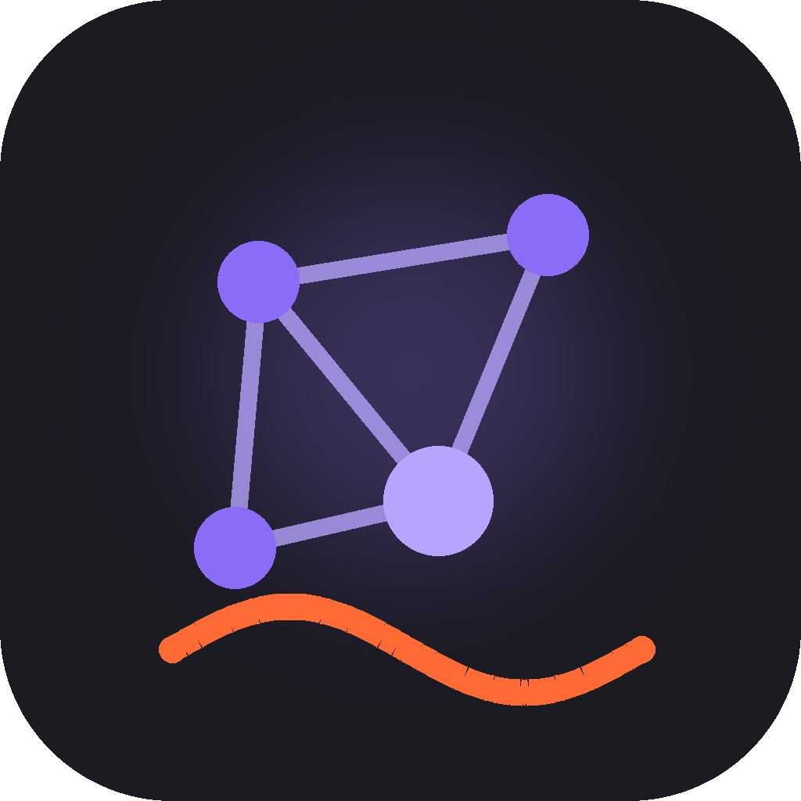
</p>

<h1 align="center">Sketchmind</h1>

<p align="center">
  Bağlantılı Markdown notlarını ve el yazısı sayfalarını tek uygulamada birleştiren, koyu mor temalı Flutter not uygulaması.
</p>

---

## 📸 Ekran görüntüleri

| Notlar | Metin notu + gömülü çizim | El yazısı | Kement + fotoğraf |
|:---:|:---:|:---:|:---:|
| 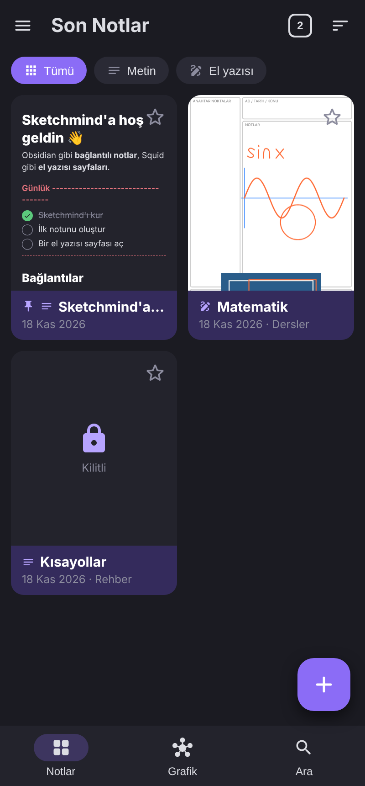 | 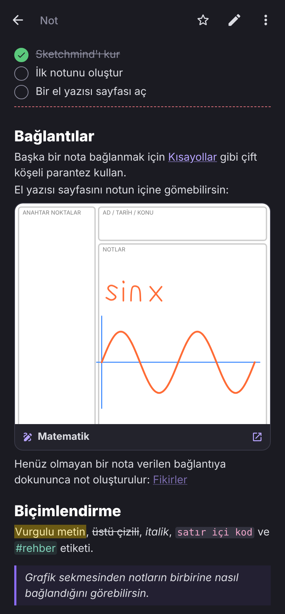 | 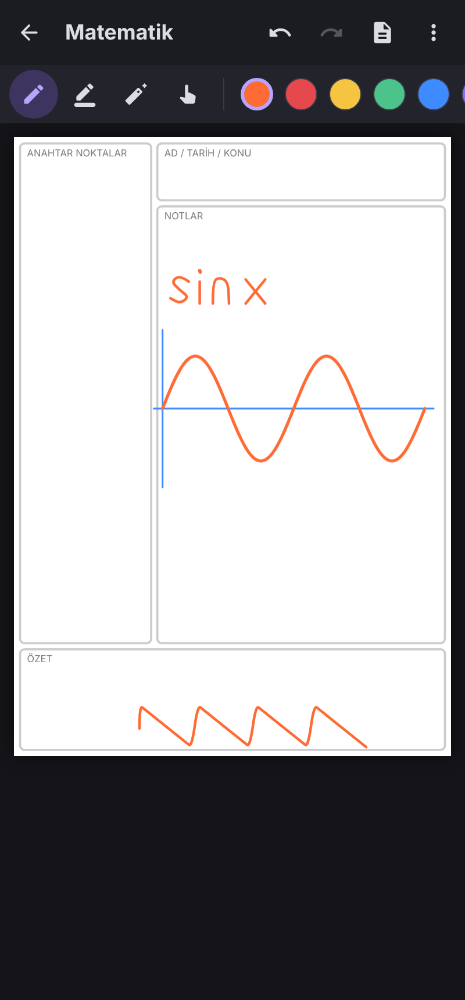 | 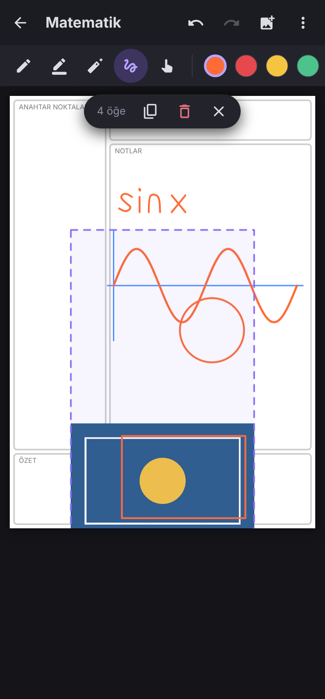 |

| PDF slaytları | Kilitli not | Çöp kutusu | Ayarlar ve yedek |
|:---:|:---:|:---:|:---:|
| 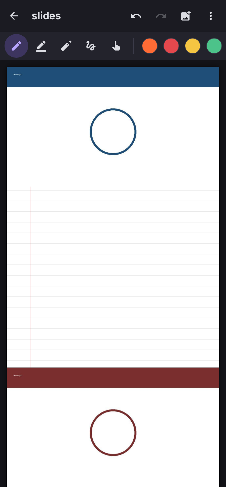 | 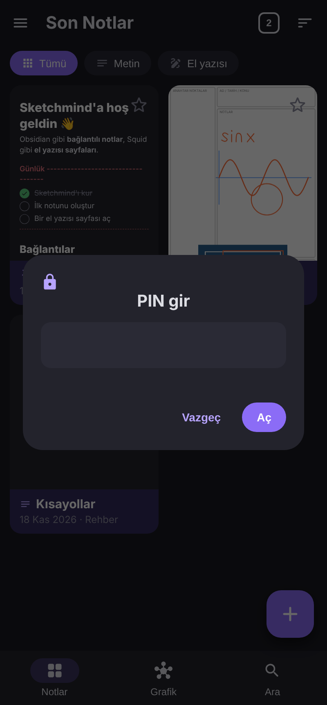 | 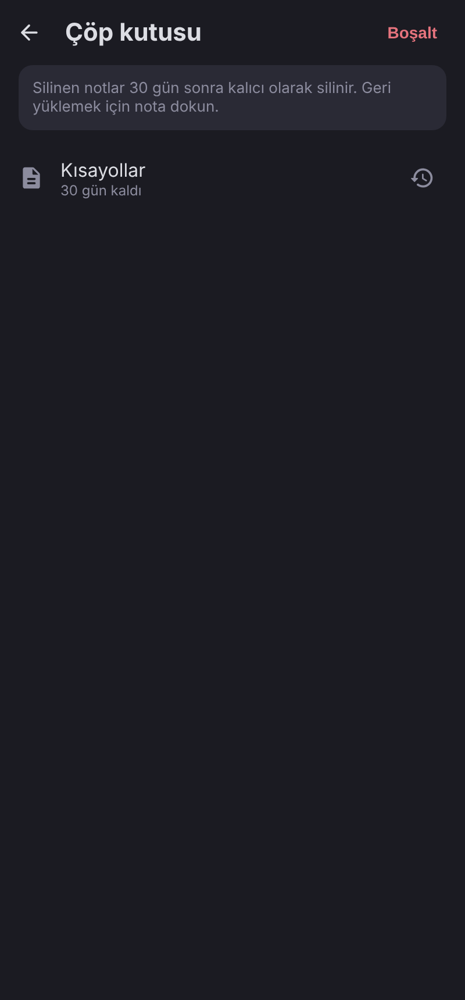 | 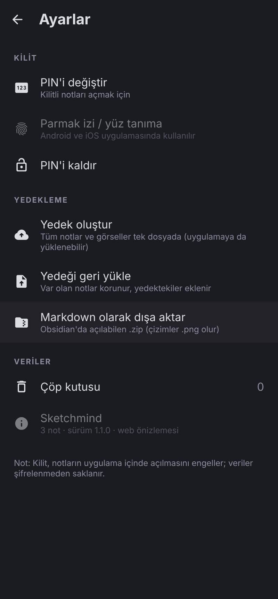 |

| Grafik | Sekmeler | Metin notu |
|:---:|:---:|:---:|
| 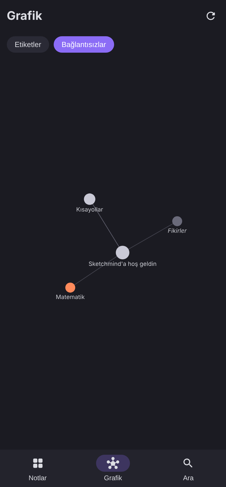 | 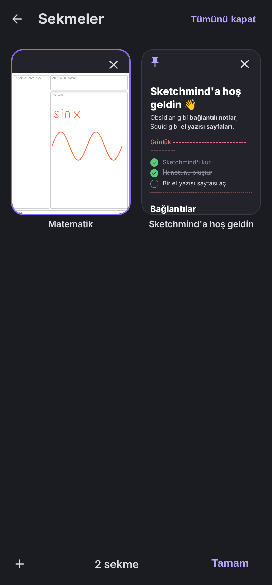 | 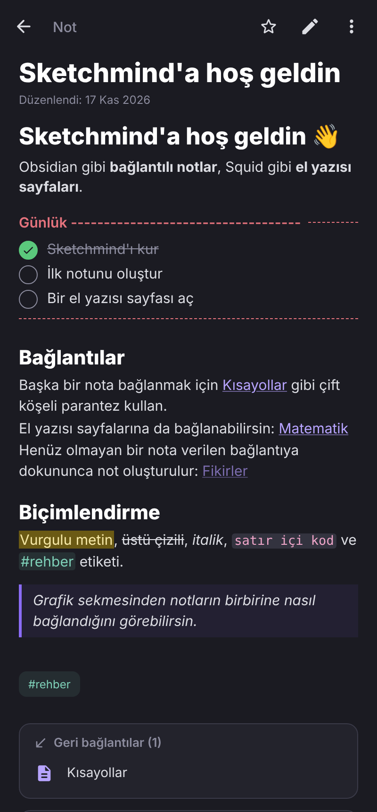 |

> Görüntüler, uygulamanın birebir web önizlemesinden (`docs/index.html`) alınmıştır.
> 🌐 Tarayıcıda denemek için: GitHub'da **Settings → Pages → Branch: main, /docs** seçince `https://muba14.github.io/sketchmind/` adresinde açılır.

## ✨ Özellikler

### 📝 Metin notları (Markdown)
- **Okuma modu / yazma modu:** Notlar okunurken biçimlendirilmiş görünür, ✏️ ile düzenlenir.
- **Yapılacaklar:** `- [ ] görev` yazılır; okuma modunda kutuya dokununca işaretlenir ve üstü çizilir.
- **Bağlantılar:** `[[Not adı]]`, `[[Not adı|takma ad]]`. Henüz olmayan bir nota verilen bağlantıya dokununca o not oluşturulur.
- **Otomatik tamamlama:** `[[` yazınca not başlıkları önerilir.
- **Not içine gömme:** `![[Matematik]]` yazınca o el yazısı sayfası notun içinde küçük resim olarak görünür; metin notları kısa önizlemeyle gömülür. Araç çubuğundaki ✏️ düğmesi listeden seçtirir ya da yeni çizim sayfası açar.
- **Geri bağlantılar:** Her notun altında, ona bağlanan ve onun bağlandığı notlar listelenir.
- **Başlık değişince** diğer notlardaki bağlantılar da güncellenir.
- `#etiket`, `==vurgu==`, `~~çizili~~`, `**kalın**`, `*italik*`, `` `kod` ``, kod blokları, alıntılar, listeler.
- `Günlük -------` gibi renkli, etiketli ayırıcı çizgiler.
- Klavyenin üstünde biçimlendirme araç çubuğu.

### ✍️ El yazısı sayfaları
- Kalem, fosforlu kalem, silgi ve kaydırma/yakınlaştırma aracı.
- 8 renk ve ayarlanabilir kalınlık (seçili araca tekrar dokun).
- **Kağıt tipleri:** düz, çizgili, kareli, noktalı, **Cornell**.
- **Kağıt renkleri:** beyaz, krem, koyu, siyah, yazı tahtası yeşili.
- Geri al / yinele, çoklu sayfa, sayfayı temizleme.
- Pürüzsüz çizgiler (Bézier yumuşatma); iki parmakla yakınlaştırma.
- **Sadece kalemle çiz** modu: parmak/avuç içi çizmez, sayfayı kaydırır.
- Kalemin silgi ucu otomatik olarak silgi gibi çalışır.
- **Kement aracı:** Çizgileri ve fotoğrafları seç, sürükleyerek taşı, köşedeki tutamaçla büyüt/küçült, çoğalt ya da sil.
- **Şekil düzeltme:** Çizginin sonunda kalemi yarım saniye sabit tut; düz çizgi, ok, üçgen, dikdörtgen ve daire kendiliğinden düzgün şekle dönüşür.
- **Fotoğraf ve PDF:** Galeriden ya da kameradan fotoğraf ekle. PDF içe aktarınca her PDF sayfası ayrı bir not sayfası olur, slaytın altına not alabilirsin.

### 🗂️ Düzen
- Önizlemeli kart ızgarası, ⭐ favoriler, 📌 sabitleme.
- Klasörler ve etiketler (yan menü).
- Son düzenlenen / oluşturulma / A-Z sıralama.
- Tür filtresi: Tümü · Metin · El yazısı.
- **Açık sekmeler** ekranı (sekme sayacı düğmesi).
- Başlık ve içerikte **tam metin arama** (eşleşmeler vurgulanır).

### 🔒 Kilit, yedek ve çöp kutusu
- **Not kilitleme:** Seçtiğin notları PIN ya da parmak izi / yüz tanımayla kilitle. Kilitli notların içeriği önizlemede, aramada ve etiketlerde görünmez. Uygulama 1 dakikadan uzun arka planda kalınca yeniden kilitlenir.
- **Yedekleme:** Tüm notlar ve görseller tek dosyaya aktarılır ve geri yüklenir (var olan notlar silinmez).
- **Markdown dışa aktarma:** Obsidian'da açılabilen bir `.zip`: metin notları `.md`, el yazısı sayfaları `.png`, gömmeler `![[Çizim.png]]` olur.
- **Çöp kutusu:** Silinen notlar 30 gün bekler; geri yüklenebilir ya da kalıcı silinebilir.

> Kilit, notların uygulama içinde açılmasını engeller; dosyalar cihazda şifrelenmeden saklanır.

### 🕸️ Grafik görünümü
- Notlar ve aralarındaki bağlantılar kuvvet yönelimli bir ağ olarak çizilir.
- Henüz oluşturulmamış notlar soluk görünür; dokunup oluşturulabilir.
- İsteğe bağlı olarak etiketleri de düğüm olarak gösterir.
- Bir düğüme dokununca komşuları vurgulanır.

## 🛠️ Kurulum

Gereksinim: [Flutter](https://docs.flutter.dev/get-started/install) 3.27 veya üstü.

```bash
git clone https://github.com/muba14/sketchmind.git
cd sketchmind

# Android/iOS platform klasörlerini oluştur (mevcut dosyaların üzerine yazmaz)
flutter create --project-name sketchmind --org com.muba14 --platforms android,ios .
python3 tool/setup_platforms.py   # parmak izi, kamera/galeri izinleri ve minSdk 24

flutter pub get
dart run flutter_launcher_icons   # uygulama simgesini uygula
flutter run
```

APK oluşturmak için:

```bash
flutter build apk --release
# build/app/outputs/flutter-apk/app-release.apk
```

Depo GitHub'a yüklendiğinde `.github/workflows/build.yml` testleri çalıştırır ve APK'yı otomatik derler. APK, Actions sekmesindeki **sketchmind-apk** artifact'ı olarak indirilebilir.

## 🧱 Proje yapısı

```
lib/
├── main.dart                  # uygulama girişi
├── theme.dart                 # koyu mor tema, renkler, tarih biçimi
├── navigation.dart            # not açma, yeni not, not menüsü, diyaloglar
├── models/note.dart           # Note, Stroke, SketchImage, bağlantı/etiket ayrıştırma
├── data/
│   ├── note_store.dart        # notlar, çöp kutusu, PIN, yedek; JSON olarak kaydeder
│   ├── media_cache.dart       # fotoğraf/PDF görsellerini çözer ve önbellekler
│   └── export.dart            # yedek paylaşma, Markdown .zip, çizimi PNG'ye çevirme
├── security/lock.dart         # PIN + parmak izi kilidi
├── sketch/shape_recognizer.dart # şekil düzeltme, kement için çokgen testi
├── widgets/
│   ├── markdown_view.dart     # canlı Markdown görünümü
│   ├── sketch_painter.dart    # kağıt tipleri, görseller ve çizgi çizimi
│   ├── embed_view.dart        # ![[gömme]] görünümü
│   └── note_card.dart         # önizlemeli not kartı
└── screens/
    ├── home_screen.dart       # alt menü, not ızgarası, yan menü
    ├── text_note_screen.dart  # Markdown editörü
    ├── sketch_note_screen.dart# el yazısı editörü
    ├── graph_screen.dart      # bağlantı grafiği
    ├── search_screen.dart     # arama
    ├── settings_screen.dart   # kilit ve yedekleme ayarları
    ├── trash_screen.dart      # çöp kutusu
    └── tabs_screen.dart       # açık sekmeler
```

Notlar cihazda `sketchmind_notes.json` dosyasında, görseller `sketchmind_media/` klasöründe saklanır. İnternet bağlantısı ve hesap gerekmez.

## 🧪 Testler

```bash
flutter test
```

## 📄 Lisans

MIT
